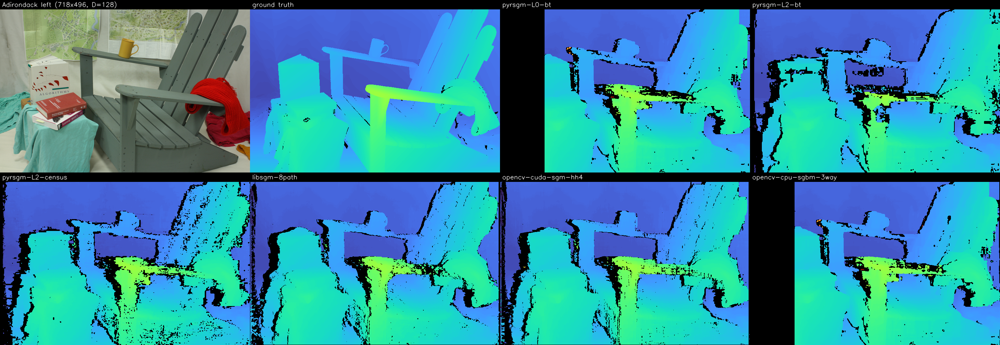

# pyrsgm — CUDA coarse-to-fine Semi-Global Matching

pyrsgm is a small, dependency-free (CUDA runtime only) C++/CUDA library for
real-time stereo disparity estimation.  It implements 3-path Semi-Global
Matching with two matching costs and a **coarse-to-fine pyramid**: the full
disparity range is searched once at 1/2ⁿ resolution and every finer level
re-evaluates only **16 local disparity labels** per pixel around the up-scaled
parent estimate.  Cost volumes therefore shrink from `W·H·D` to `W·H·16`, which
makes large disparity ranges (D = 256 and beyond) cheap at full resolution.

The kernels were extracted verbatim from the production tri-camera depth engine
**Tri3SGM** (`core/src/cuda_3sgm.cu`); this repository adds a standalone
`StereoMatcher` API, a CUDA `pyrDown`, tests, and a benchmark against
[fixstars libSGM](https://github.com/fixstars/libSGM) and OpenCV's
`cv::cuda::StereoSGM`.



## Features

* **Costs**: Birchfield–Tomasi on gradient + intensity with `block_size²` SAD
  aggregation (bit-compatible with OpenCV `StereoSGBM` `MODE_SGBM_3WAY`), or 5×5
  Census + Hamming.
* **Aggregation**: 3 SGM paths (left→right, top→bottom, right→left fused with
  WTA); optional adaptive P2 driven by the intensity gradient.
* **Pyramid** (`pyramid_levels` 1–4): coarse full-range search at 1/2…1/16
  resolution, then 16-label refinement per level.  Only pixels that passed
  uniqueness, confidence and a strict pseudo left–right check are propagated;
  SGM paths reset at invalid pixels; local labels are mapped to real
  disparities so neighbouring pixels with different search windows interact
  correctly.
* **Outputs**: 16-bit fixed point (`disparity × 16`, OpenCV convention),
  float disparity, and a per-pixel confidence in [0, 1].
* Post-processing: uniqueness ratio, pseudo LR check, 1/16-pixel sub-pixel
  interpolation, optional 3×3 median.
* Allocation-free, fully asynchronous `compute()` on a user stream; one
  `StereoMatcher` per image size; multiple instances can run on independent
  streams.
* Low-level C API (`pyrsgm_c.h`) exposing the single-scale and per-level
  entry points for integration into existing pipelines.

## Benchmark

Hardware: NVIDIA GeForce RTX 5070 Ti **Laptop** GPU (sm_120, 65 W power cap,
clocks not locked), CUDA 12.8, OpenCV 4.12.0 with CUDA, libSGM 3.1 (master).
Every GPU algorithm reads and writes device memory; times are CUDA-event medians
over 3 × 30 iterations after ≥ 500 ms warm-up per algorithm (see
[docs/BENCHMARK.md](docs/BENCHMARK.md) for the methodology and parameters).
Full tables: [docs/results](docs/results).

### Middlebury 2014 trainingQ (15 scenes, ~700×480, D = 64/128/256 per scene)

| algorithm | paths | cost | GPU ms | FPS | density % | bad1 % (valid) | avg err px | **bad1 % (all)** |
|---|---|---|---:|---:|---:|---:|---:|---:|
| pyrsgm-L0-bt (single scale) | 3 | BT 5×5 | 5.68 | 176 | 78.0 | 14.89 | 1.78 | 33.33 |
| pyrsgm-L1-bt | 3 | BT 5×5 | 4.78 | 209 | 88.6 | 16.48 | 1.83 | **25.55** |
| pyrsgm-L2-bt | 3 | BT 5×5 | 5.74 | 174 | 85.7 | 17.83 | 2.26 | 28.98 |
| pyrsgm-L3-bt | 3 | BT 5×5 | 5.31 | 188 | 85.6 | 18.48 | 2.43 | 29.63 |
| pyrsgm-L0-census (single scale) | 3 | Census 5×5 | 4.86 | 206 | 78.9 | 14.52 | 1.34 | 32.34 |
| pyrsgm-L2-census | 3 | Census 5×5 | 3.10 | 322 | 85.7 | 15.02 | 1.39 | 26.85 |
| opencv-cuda-sgm-hh | 8 | Census 9×7 | 2.75 | 364 | 88.7 | 15.54 | 1.44 | 24.84 |
| opencv-cuda-sgm-hh4 | 4 | Census 9×7 | 1.71 | 585 | 88.4 | 15.37 | 1.55 | 24.91 |
| libsgm-8path | 8 | Census 9×7 | 2.89 | 346 | 88.6 | 15.45 | 1.42 | 24.86 |
| libsgm-4path | 4 | Census 9×7 | 1.72 | 581 | 88.3 | 15.30 | 1.54 | 24.94 |
| opencv-cpu-sgbm-3way (CPU) | 3 | BT 5×5 | 12.28 | 81 | 77.9 | 14.93 | 1.81 | 33.41 |

`bad1 % (all)` counts invalid pixels as errors (MiddEval3 convention); the
other accuracy columns are over valid pixels only.

* `pyrsgm-L0-bt` reproduces OpenCV's CPU `MODE_SGBM_3WAY` almost exactly
  (density 78.0 vs 77.9 %, bad1 14.89 vs 14.93 %, avg err 1.78 vs 1.81 px) at
  2.2× its speed on this laptop — the BT path is a faithful GPU port.
* The pyramid raises density from 78 % to 86–89 % and lowers `bad1 (all)` by
  5–8 points because the coarse levels resolve low-texture regions that the
  single-scale search rejects.  Sub-pixel accuracy on valid pixels drops
  slightly (16 labels, 3×3 BT window at coarse levels).
* On these small images the libSGM/OpenCV kernels are 1.7–3× faster: their
  per-row work is dominated by kernel launch latency and 16-thread refinement
  blocks that leave most of the GPU idle (see *Performance notes*).

### Resolution scaling (Adirondack resized, timing only, GPU ms)

| size | D | pyrsgm-L0-bt | pyrsgm-L2-bt | pyrsgm-L2-census | libsgm-8path | libsgm-4path | opencv-cuda-sgm-hh | opencv-cuda-sgm-hh4 | CPU sgbm-3way |
|---|---:|---:|---:|---:|---:|---:|---:|---:|---:|
| 640×480 | 128 | 5.18 | 6.10 | 3.17 | 2.53 | 1.56 | 2.29 | 1.57 | 12.3 |
| 960×540 | 128 | 8.38 | 8.01 | 4.28 | 4.11 | 2.71 | 4.44 | 3.00 | 22.3 |
| 1280×720 | 128 | 19.04 | 16.03 | 8.37 | 8.55 | 4.51 | 7.75 | 4.20 | 40.5 |
| 1920×1080 | 128 | 35.60 | 28.82 | **14.30** | 18.36 | 9.85 | 17.81 | 9.59 | 106.4 |
| 960×540 | 256 | 18.40 | 8.55 | **4.92** | 8.70 | 4.63 | 9.12 | 4.36 | 34.9 |
| 1280×720 | 256 | 30.31 | 14.18 | **8.09** | 15.74 | 8.44 | 14.07 | 7.59 | 72.9 |
| 1920×1080 | 256 | 72.68 | 30.37 | **15.66** | 35.34 | 18.11 | fail¹ | 18.45 | 193.3 |

¹ `cv::cuda::StereoSGM` `MODE_HH` asserts on the cost-buffer size at
1920×1080 × D = 256 (OpenCV 4.12.0).

The pyramid's cost is almost independent of `D` (the coarse level runs at 1/4
resolution with D/4 labels, the refinements always use 16): going from D = 128
to D = 256 at 1080p adds 1.4 ms for `pyrsgm-L2-census` but doubles libSGM
(18.4 → 35.3 ms, 8 paths) and OpenCV HH4 (9.6 → 18.5 ms).  At 1080p/D = 256
`pyrsgm-L2-census` is the fastest configuration in the table and the only one
below 16 ms, while at small images and D ≤ 128 the 4-path libSGM kernels win.

### Performance notes (where the time goes)

`scripts/profile_kernels.sh pyrsgm-L2-census 960x540 128` (Nsight Systems):

| kernel | share | per frame |
|---|---:|---:|
| `kernel_SGM_PathRLPyramidWTA` (3 levels) | 50.8 % | 2.27 ms |
| `kernel_SGM_PathLRPyramid` (3 levels) | 22.8 % | 1.02 ms |
| `kernel_SGM_PathTBPyramid` (3 levels) | 19.8 % | 0.89 ms |
| `kernel_CensusCostLocal` (2 refine levels) | 2.9 % | 0.13 ms |
| everything else (census, median, LR check, pyrDown, …) | 3.7 % | 0.17 ms |

For the BT pyramid the picture is different: `kernel_BTWindowCostLocal`
(direct 5×5 window × 16 labels evaluation at the refinement levels) takes
~39 % because the separable box filter of the single-scale path cannot be
applied when each pixel owns a different label window.

The refinement path kernels launch one block of **16 threads per image
row/column** (one thread per local label) and sweep the row serially, so a
960×540 refinement level runs on only 540 half-warps — far below what the GPU
can schedule.  libSGM instead packs several pixels per warp and uses
register-resident costs.  Obvious next steps, in order of expected gain:

1. process several rows per block in the pyramid path kernels (e.g. 8 rows →
   128 threads, per-half-warp shuffle reductions);
2. replace the direct window evaluation in `kernel_BTWindowCostLocal` with a
   tile-cached per-pixel BT cost in shared memory;
3. fuse the three path kernels of a level into fewer launches or overlap LR/TB
   on two streams (the TB pass only needs the raw cost volume);
4. 8-bit cost storage for Census (Hamming ≤ 24) to halve cost-volume traffic.

None of these change the algorithm; the current kernels are the ones validated
in production and by the tests below.

## Building

Requirements: CMake ≥ 3.18, a C++17 compiler, CUDA Toolkit ≥ 11 (tested with
12.8), a GPU with compute capability ≥ 7.5.  The library itself has **no other
dependency**; the benchmark and the example need OpenCV (the benchmark needs an
OpenCV build with CUDA, and `cudastereo` for `cv::cuda::StereoSGM`).

```bash
git clone https://github.com/gegeges/pyrsgm.git && cd pyrsgm
cmake -S . -B build -DCMAKE_BUILD_TYPE=Release        # auto-detects the local GPU arch
cmake --build build -j
ctest --test-dir build                                  # pyramid_smoke + matcher_test
```

Useful options: `-DCMAKE_CUDA_ARCHITECTURES="75;86;89;120"`,
`-DPYRSGM_BUILD_BENCH=OFF`, `-DPYRSGM_BUILD_EXAMPLES=OFF`, `-DPYRSGM_SHARED=ON`,
`-DOpenCV_DIR=/path/to/lib/cmake/opencv4`, `-DLIBSGM_ROOT=/path/to/libsgm/install`.
`cmake --install build` exports a `pyrsgm::pyrsgm` CMake target
(`find_package(pyrsgm)`).

## Usage

```cpp
#include <pyrsgm/pyrsgm.h>

pyrsgm::Params p;
p.num_disparities = 256;                 // full-resolution search range
p.pyramid_levels  = 2;                   // full search at 1/4, 16-label refine at 1/2 and 1/1
p.cost_mode       = pyrsgm::CostMode::Census;
p.p1 = 8; p.p2 = 32;                     // Census penalties (BT: 300 / 2400)

pyrsgm::StereoMatcher sgm(width, height, p);   // allocates everything once

// d_left / d_right: 8-bit grayscale rectified images in device memory (pitched)
sgm.compute(d_left, left_pitch, d_right, right_pitch,
            d_disp16, disp16_pitch,      // int16, disparity*16, invalid = (min_disparity-1)*16
            d_disp32, disp32_pitch,      // float px, invalid = 0        (optional, nullptr)
            d_conf,   conf_pitch,        // float [0,1]                  (optional, nullptr)
            stream);                     // fully asynchronous
```

`pyrsgm_stereo_pair left.png right.png out 128 2 census` (built with OpenCV)
runs the matcher on a rectified pair and writes a colour-mapped PNG, a
confidence PNG and a PFM.

### Parameters

| parameter | meaning |
|---|---|
| `num_disparities` | search range at full resolution (multiple of 16, ≤ 1024) |
| `min_disparity` | minimum disparity (pyramid requires 0) |
| `block_size` | BT SAD window, odd ≥ 3; levels ≥ 2 use 3×3 |
| `cost_mode` | `BirchfieldTomasi` or `Census` |
| `p1`, `p2` | smoothness penalties in cost units (BT ≈ 25 × [0,255] sums; Census ∈ [0,24]) |
| `uniqueness_ratio` | WTA margin in %, 0 disables |
| `disp12_max_diff` | pseudo LR check tolerance in px (pyramid requires ≥ 0) |
| `lr_check`, `median_filter` | final-level post-processing switches |
| `num_paths` | 3 (default), 2 (no top→bottom) or 1 (right→left only) |
| `pyramid_levels` | 0 = single scale; 1–4 = coarse search at 1/2 … 1/16 |
| `pyramid_coarse_disparities` | cap on labels evaluated at the coarsest level (effective: `align16(min(cap, level_max + 1))`) |
| `pyramid_max_disparity` | largest full-resolution disparity (default `num_disparities − 1`) |
| `pyramid_min_confidence` | parents below this confidence are not propagated |
| `adaptive_p2`, `p2_alpha`, `p2_beta`, `p2_lower_mult`, `p2_upper_mult` | `P2' = P2·(lower + (1+α−lower)·exp(−|ΔI|/β))` clamped to `[P2·lower, P2·upper]` |

### Algorithm summary

1. Gaussian 5×5 pyramid of both views (`pyrsgm_pyrdown_u8`, `cv::pyrDown`-compatible).
2. Coarsest level: full search over `align16(min(coarse_cap, D/2ⁿ))` labels with
   the selected cost, 3-path SGM, WTA + uniqueness + sub-pixel, strict pseudo LR
   check; the result carries a confidence `(second_best − best) / best`.
3. Each finer level: parent disparity `×2` defines a 16-label window
   `[−8,+7]` or `[−7,+8]` (chosen from the parent's sub-pixel fraction), clamped
   to the geometric range.  Invalid or low-confidence parents stay invalid.
   Costs are evaluated only for the 16 labels; the SGM recursion maps a
   neighbour's label index to the same *real* disparity before applying
   `P1`/`P2`, and resets at invalid pixels.
4. Final level: configured LR check and optional 3×3 median; float disparity
   and confidence are written alongside the 16-bit map.

## Tests

* `pyrsgm_pyramid_smoke` — chains a real coarse result through four refinement
  levels (1/16 → 1/1), exercises spatially varying parent windows, BT and
  Census, 1/2/3 paths and the single-scale entry point.
* `pyrsgm_matcher_test` — parameter validation, `pyrDown` against a CPU
  reference (bit-exact), and `StereoMatcher` at levels 0–4 × {BT, Census} on
  synthetic constant and slanted-plane scenes (> 99 % of pixels within 1 px,
  mean error ≈ 0.13 px on the slanted plane), output subsets and level geometry.

Both pass under Compute Sanitizer `memcheck`, `initcheck` and `racecheck`.

## Repository layout

```
include/pyrsgm/   pyrsgm.h (C++ API), pyrsgm_c.h (C API)
src/              sgm_kernels.cu (all SGM / pyramid kernels), pyrdown.cu, stereo_matcher.cpp
tests/            pyramid_smoke.cpp, matcher_test.cpp
bench/            pyrsgm_bench.cpp (+ middlebury.h): timing & Middlebury metrics
examples/         stereo_pair.cpp
scripts/          download_middlebury.sh, build_libsgm.sh, run_benchmark.sh,
                  profile_kernels.sh, make_montage.py
docs/             BENCHMARK.md, results/ (CSV + markdown + montages)
```

## Relationship to Tri3SGM

The kernels in `src/sgm_kernels.cu` are the `cuda_3sgm.cu` kernels of the
Tri3SGM tri-camera engine with the engine-specific device code (LR/LT fusion,
LT→LR remap, rotation, depth colouring) removed and the C entry points renamed
(`cuda_3sgm_compute_with_workspace` → `pyrsgm_compute_single_scale`,
`cuda_3sgm_compute_pyramid_level_with_workspace` → `pyrsgm_compute_level`).
The host-side level scheduling in `StereoMatcher` mirrors
`Tri3SgmEngine::runPyramid`, with `cv::cuda::pyrDown` replaced by an
OpenCV-compatible CUDA kernel so the library has no OpenCV dependency.
Inline comments inside the kernels are kept verbatim from the original
(partly Chinese).

## License

MIT (see `LICENSE`).  libSGM (Apache-2.0) and OpenCV (Apache-2.0) are only used
by the benchmark and are downloaded/linked at build time, not vendored.  The
Middlebury 2014 dataset is subject to its own terms of use.

---

## 中文说明

pyrsgm 是从 Tri3SGM 三目深度引擎中抽出的独立 CUDA 立体匹配库：3 路径 SGM，
BT（与 OpenCV `StereoSGBM MODE_SGBM_3WAY` 逐像素一致）或 5×5 Census 代价，
并提供粗到细金字塔——最低分辨率做完整视差搜索，之后每层只在父层视差附近精化
16 个局部标签，代价体从 `W·H·D` 降到 `W·H·16`，因此大视差范围（D≥256）下
全分辨率的耗时几乎不随 D 增长。

* 只依赖 CUDA runtime；`StereoMatcher` 构造时一次性分配显存，`compute()`
  完全异步、无分配，可在用户 stream 上运行。
* 输出 16 位定点视差（×16，OpenCV 约定）、浮点视差和 [0,1] 置信度。
* 另提供 C API（`pyrsgm_c.h`），与 Tri3SGM 中的 `cuda_3sgm_*` 接口一一对应。

基准（RTX 5070 Ti Laptop，65 W 功耗墙）：

* Middlebury trainingQ 15 场景：`pyrsgm-L0-bt` 与 OpenCV CPU 3WAY 结果几乎一致
  （bad1 14.89 % vs 14.93 %），速度 2.2×；金字塔把密度从 78 % 提到 86–89 %，
  bad1(含空洞) 从 33 % 降到 25.5 %（L1）；在 ~700×480 的小图上 libSGM/OpenCV
  4 路径核仍快 1.7–3×。
* 1920×1080、D=256：`pyrsgm-L2-census` 15.7 ms，libSGM 4 路径 18.1 ms、
  8 路径 35.3 ms，OpenCV HH4 18.5 ms（HH 在该尺寸断言失败）；金字塔耗时基本
  不随 D 增长。
* 性能瓶颈已用 nsys 定位：精化层路径核每行只有 16 个线程，占用率极低；
  BT 精化层的窗口代价核直接计算 5×5×16 个代价。README 的 *Performance notes*
  列出了不改变算法的优化方向。

复现：`scripts/download_middlebury.sh` → `scripts/build_libsgm.sh` →
`cmake -S . -B build -DOpenCV_DIR=...` → `scripts/run_benchmark.sh`。
